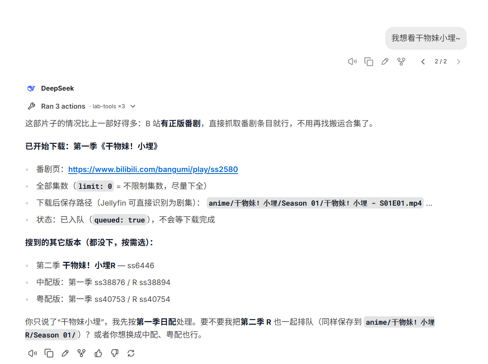
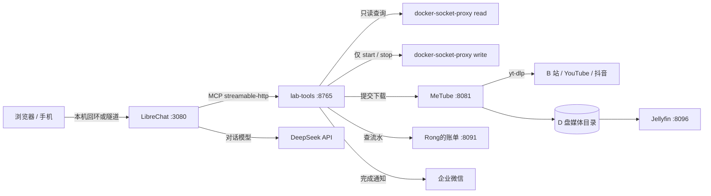

# Homelab · 说一句话，番剧自己落到硬盘里

一台 Windows 主机上的 WSL2（Ubuntu 24.04）自托管实验室：Docker Compose 管理二十多个容器，LibreChat + DeepSeek 通过 MCP 调用自建的 `lab-tools`，把「聊天」变成真正能查状态、启停服务、搜片源、下载视频的操作入口。



> 「我想看干物妹小埋~」
>
> → B 站搜索番剧 → 选中第一季正片 → 按 `anime/干物妹！小埋/Season 01/干物妹！小埋 - S01E01.mp4` 落盘 → 下载完成推送企业微信
>
> 全程不用打开下载站，也不用记路径。

## 这是什么

- **不是一键部署模板**：仓库是从一台长期运行的机器上抽出来的配置与服务源码，WSL 发行版、虚拟磁盘、媒体文件、凭据都不入库。
- **AI 是操作层，不是聊天玩具**：模型只能调用白名单工具，写操作要二次确认，所有动作落审计日志。
- **数据都在 D 盘**：WSL 的 `ext4.vhdx`、容器卷、媒体库、备份全部避开系统盘。
- **默认只监听回环**：除 Dockge（需要经 frp 远程打开）外，管理类服务全部绑定 `127.0.0.1`，远程访问走隧道。

## 项目组成

| 模块 | 位置 | 说明 |
| --- | --- | --- |
| AI 工具服务 | [homelab/lab-tools](homelab/lab-tools) | MCP over HTTP，13 个工具：容器查询/启停、健康快照、磁盘占用、片源搜索、下载、账单查询 |
| 聊天前端 | [homelab/librechat](homelab/librechat) | LibreChat + DeepSeek，通过 `librechat.yaml` 挂载 `lab-tools` |
| 下载执行器 | [homelab/metube](homelab/metube) | MeTube / yt-dlp，接收 URL 并按目标目录落盘 |
| 媒体库 | [homelab/jellyfin](homelab/jellyfin) | 只读挂载 D 盘各媒体目录，番剧按剧集结构识别 |
| 电源面板 | [homelab/power](homelab/power) | 按组一键 stop/start，临时释放内存；宿主机 systemd 服务也能管 |
| 记账 | [homelab/bill-ai](homelab/bill-ai) | 「Rong的账单」：截图/CSV/XLSX 账单识别 + 本地账本（SQLite） |
| 统一图标 | [homelab/branding](homelab/branding) | 一条命令生成全站 favicon / logo / 头像 |
| 备份 | [homelab/backup](homelab/backup)、[homelab/mc-backup](homelab/mc-backup) | 账单每日快照、Minecraft 世界每日归档 |
| 宿主机服务 | [homelab/mcsmanager](homelab/mcsmanager)、[homelab/power/host-agent](homelab/power/host-agent) | MCSManager / 1Panel 的 systemd 单元与受控代理 |
| Windows 小工具 | [tools/startup-panel](tools/startup-panel)、[tools/gen-port-table.ps1](tools/gen-port-table.ps1) | 开机自启项管理面板、端口表生成 |

## 架构



Docker 访问被拆成两个 socket proxy：读代理能查容器但不能写，写代理只放行 `start` / `stop`，不开放 `exec`、`create`、`kill`、卷和网络操作。

## 核心功能：自然语言下载

`download_media` 接受三种输入：

| 你说的话 | 模型传参 | 行为 |
| --- | --- | --- |
| 「下载 https://www.bilibili.com/bangumi/play/ss2580 到动漫」 | `url` + `target="anime"` | 直接提交给 MeTube |
| 「7.43 复制打开抖音…」整段分享口令 | `url`（自动提取链接） | 从文本里抽 `http(s)` 链接 |
| 「我想看干物妹小埋~」 | `query="干物妹小埋"` | 先搜 B 站，选匹配度最高的正片再下载 |

几个细节：

- **目标目录是枚举，不是路径**：只接受 `game_video`、`yt_video`、`movies`、`anime`，模型无法拼出 `/etc` 或系统目录。
- **番剧按 Jellyfin 规范落盘**：`target=anime` 且带剧名时，自动写成 `anime/<剧名>/Season 01/<剧名> - S01E01.mp4`，Jellyfin 直接识别为剧集，不用手动刮削整理。
- **支持选集和限量**：`items="10-13"` 只下这几集，`limit=3` 只要前 3 项，`limit=0` 表示全下（上限 100）。
- **提交即返回**：`{"queued": true}`，不阻塞对话；后台线程轮询 MeTube `/history`，结束或失败时推送企业微信，状态存 `/audit/downloads.json`，重启不丢。
- **搜不到就问**：多个候选版本会连同链接一起返回，由模型决定是换关键词还是让用户选。

### MCP 工具清单

| 工具 | 类型 | 作用 |
| --- | --- | --- |
| `health_snapshot` | 只读 | 一次拿到全部容器状态、异常容器、错误日志、磁盘占用 |
| `list_services` / `service_status` / `service_logs` | 只读 | 容器清单、单容器详情、最近日志 |
| `disk_usage` | 只读 | 镜像/容器/卷/构建缓存的总量与可回收量 |
| `search_bilibili` / `search_youtube` | 只读 | 按片名搜索，返回可下载链接 |
| `recent_expenses` / `largest_expenses` | 只读 | 查最近流水、指定周期内最大支出 |
| `download_media` | 写 | 提交下载任务 |
| `start_service` | 写 | 启动已停止的容器 |
| `stop_service` / `restart_service` | 写 + 确认 | 首次调用只返回 `confirm_token`，确认后才执行 |

### 为什么下载不用 Pinchflat

Pinchflat 的模型是「订阅源 + 定时检查」，适合 YouTube 频道归档；一次性贴链接/报片名的场景交给 MeTube（底层同样是 yt-dlp），两者都写同一批目录，Jellyfin 只管播放。

## 安全设计

这不是「把 docker.sock 丢给大模型」的玩法，边界都写死在代码和 compose 里：

1. **两段式确认**：`stop_service` / `restart_service` 第一次只返回命令预览和一次性 token（120 秒过期），带上 token 再调才执行。
2. **保护名单**：`lab-tools`、两个 proxy、`librechat`、`librechat-mongo`、`homarr`、`dozzle`、`frpc` 禁止 stop / restart，避免把入口或 Agent 自己关掉。
3. **最小权限代理**：见上节；写代理连 `GET /containers/json` 都会 403。
4. **路径白名单**：下载目标只认四个枚举值，映射关系固定。
5. **审计**：每次启停追加一行 JSON 到 `lab_tools_audit` 卷（时间、动作、目标、结果、token）。
6. **宿主机操作白名单**：`power/host-agent` 只允许 `mcsm-daemon.service`、`mcsm-web.service`、`1panel.service` 的 start/stop，不接任意命令。
7. **默认回环**：除 Dockge 外所有 Web 服务绑定 `127.0.0.1`；Dockge 挂着 `docker.sock`、等价宿主机 root，必须自行加认证或走隧道，不能无鉴权暴露到公网。

## 服务清单

| 服务 | 作用 | 端口 |
| --- | --- | --- |
| Dockge | Compose 控制台 | `5001` |
| Homarr | 首页看板 | `7575` |
| Dozzle | 容器日志面板 | `8888` |
| Beszel | 资源监控 | `8090` |
| LibreChat | AI 聊天入口 | `3080` |
| lab-tools | MCP 工具服务 | `8765` |
| MeTube | 一次性视频下载 | `8081` |
| Pinchflat | YouTube 订阅归档 | `8945` |
| Jellyfin | 影视库 | `8096` |
| Cloudreve | 网盘 | `8080` |
| Vaultwarden | 密码管理 | `8082` |
| Traccar | 位置追踪（上报端口 5055） | `8085` |
| Rong的账单 | 记账 + 账单识别 | `8091` |
| 电源面板 | 按组启停容器 / 宿主机服务 | `8092` |
| Minecraft | Forge 1.20.1 服务器 | `25565` |
| Palworld | 幻兽帕鲁服务器 | `8211` |
| frpc | 内网穿透客户端 | host 网络 |

宿主机另有 MCSManager（`23333`）和 1Panel（`25081`），由 systemd 管理，不在容器列表里。端口表由 `tools/gen-port-table.ps1` 扫描 compose 生成，是 `AGENTS.md` 表格的唯一来源。

## 快速开始

前提：Windows 11 + WSL2、一块数据盘（本项目用 `D:`）、一个 DeepSeek API Key。

1. **导入 Ubuntu 到数据盘**（不要用 Store 安装，否则落在 C 盘）：

   ```powershell
   wsl --import UbuntuD D:\ubuntu_\UbuntuD <rootfs.tar.gz> --version 2
   ```

2. **在发行版内安装 Docker Engine**，把日常用户加入 `docker` 组（重开终端生效）。

3. **准备媒体目录**，按需改 compose 里的挂载路径：

   ```text
   D:\game_video_   D:\yt_video_   D:\mv__   D:\for_jellyfin\anime
   ```

4. **放置配置**（这些文件都不入库）：

   ```bash
   cp homelab/librechat/.env.example homelab/librechat/.env   # 填 DEEPSEEK_API_KEY、CREDS_KEY、JWT_SECRET 等
   cp homelab/lab-tools/.env.example homelab/lab-tools/.env   # 企业微信通知可选
   # homelab/bill-ai/.env 需要 DEEPSEEK_API_KEY
   # homelab/metube/cookies.txt 放 B 站登录态（Netscape 格式，权限 600）
   ```

5. **按依赖顺序启动**。`lab-tools` 依赖 `bill-ai_default` 和 `metube_default` 两个外部网络，先起它们：

   ```bash
   cd ~/homelab/metube && docker compose up -d
   cd ~/homelab/bill-ai && docker compose up -d
   cd ~/homelab/lab-tools && docker compose up -d
   cd ~/homelab/librechat && docker compose up -d
   ```

6. **自检**：打开 LibreChat，问「机器现在怎么样」。模型会调用 `health_snapshot`，返回容器状态、异常项和磁盘占用。

`~/homelab` 是运行位置（Dockge 挂载的是 `~/homelab/stacks`）；仓库里的 `homelab/` 只是源文件，不会自动同步进 WSL。

## 目录结构

```text
.
├─ homelab/
│  ├─ lab-tools/          MCP 服务（FastMCP + Docker SDK + MeTube 客户端）
│  ├─ librechat/          聊天前端与模型/工具配置
│  ├─ metube/             yt-dlp 下载器
│  ├─ jellyfin/           影视库
│  ├─ power/              电源面板 + 宿主机 systemd 代理
│  ├─ bill-ai/            记账服务（FastAPI + SQLite + 静态页面）
│  ├─ backup/             统一备份脚本与 timer
│  ├─ mc/ mc-backup/      容器化 MC 与另一实例的每日归档
│  ├─ mcsmanager/         宿主机 systemd 单元
│  ├─ branding/           全站图标生成脚本
│  └─ <其他服务>/          每个目录一份自包含 compose
├─ tools/
│  ├─ startup-panel/      Windows 开机自启管理面板
│  └─ gen-port-table.ps1  由 compose 生成端口表
├─ docs/                  README 截图
├─ AGENTS.md              给 AI 编码代理的项目约束与踩坑记录
└─ .gitignore             排除虚拟磁盘、媒体、凭据、缓存
```

## 备份

- **账单**：`backup.sh` 每天从 `/api/backup.db` 拉 SQLite 在线快照和 CSV，写到 `D:\ubuntu_\.cache\backup\bill-ai\`，保留 14 天。
- **Minecraft**：`mc-backup.sh` 先 `docker pause` 保证世界文件一致，再打包实例目录，本地和 D 盘各留 7 天。
- 两个任务都由 systemd timer 触发，脚本在仓库内，安装步骤见 `AGENTS.md`。

## 存储约定

- WSL 发行版、交换文件、镜像、卷、备份全部在 D 盘；C 盘只允许 WSL/Windows 程序本体。
- 容器数据放 ext4 命名卷，只有大体积只读媒体挂 `/mnt/d/...`（9P 性能差，不适合可写数据库）。
- 项目产物统一进 `.cache/<类别>/`，仓库根目录保持干净。

## 已知限制

- **YouTube 需要代理**：当前容器网络访问不了 YouTube，`search_youtube` 会明确返回不可达；抖音只支持贴链接，网页搜索接口需要签名。
- **B 站高码率/大会员内容需要 cookies**：MeTube 和搜索共用同一份 `cookies.txt`，失效后 412 风控会变多。
- **MeTube 单并发**：`MAX_CONCURRENT_DOWNLOADS=1`，避免同时下载把 9P 挂载打满。
- **仓库不含安装器**：WSL 导入、Docker 安装、宿主机 systemd 单元需要按上面的步骤手动完成；`AGENTS.md` 记录了完整命令和坑。
- **Minecraft 有两套实例**：`homelab/mc` 是容器，另一套由 MCSManager 托管，`mc-backup` 备份的是后者，改配置前先确认对象。

## 更多文档

- [AGENTS.md](AGENTS.md)：项目约束、C 盘禁令、排错速查、运维命令
- [lab-tools/AGENT-REQUIREMENTS.md](homelab/lab-tools/AGENT-REQUIREMENTS.md)：能力清单、权限拆分、验收标准
- [branding/README.md](homelab/branding/README.md)：一键换全站图标

个人自用项目，未附开源许可证；架构和权限设计可以随意参考。
